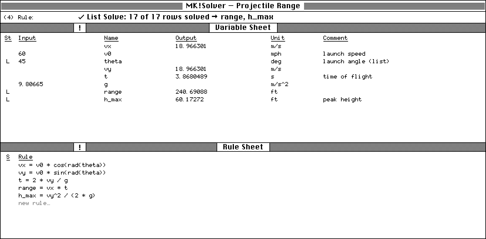

# MK!Solver

A browser-based, declarative equation solver modeled on **TK!Solver**, the
1980s program where you typed equations in any order, entered whatever you
knew, and it solved for the rest, iterating from your guesses when it had to.
The name honors TK!Solver's inventor, **Milos Konopasek** (MK).

No build step, no dependencies, no server. Use it online at
https://holla2040.github.io/MKSolver/, or download the single file
[`dist/MKSolver.html`](https://holla2040.github.io/MKSolver/dist/MKSolver.html)
and open it from your disk.



## Running it

* **Online:** https://holla2040.github.io/MKSolver/ is deployed by `.github/workflows/pages.yml` on every push to `main`, after the engine tests pass.
* **Offline, one file:** download [`dist/MKSolver.html`](https://holla2040.github.io/MKSolver/dist/MKSolver.html) (in the browser, File → Save Page As) and open it. The styles, fonts and code are all inside it, so it works from your disk with no other files.
* **From a clone:** open `index.html`. It needs the `css/`, `js/` and `fonts/` folders beside it, so downloading `index.html` by itself gives an unstyled page that doesn't work. Use the single file for that.
* **Test the engine:** `npm test` (Node 18+, no packages needed).
* **Rebuild the single file:** `npm run build`. This inlines `css/`, `js/` and `fonts/` into `dist/MKSolver.html`.

## How to use it

1. Type equations in the **Rule Sheet**, one per line. `a + b = c / d` is fine; rules are equations, not assignments.
2. Each variable shows up in the **Variable Sheet**. Put known values in **Input**.
3. Press **!** (or F9, or Ctrl+Enter). Answers appear in **Output**.
4. To work backwards, double-click an output to move it to Input, clear a different input, and press **!** again.

| St | Meaning |
|----|---------|
| *(blank)* | A value in Input is a known input. With no value, the variable is an unknown. |
| `G` | The Input value is a **guess**: a starting point for the iterative solver. |
| `L` | The variable is linked to a **list** of the same name, for List Solve and plots. |

Rule Sheet marks: `*` means the rule isn't satisfied (inconsistent inputs), `!` means a syntax error, and `·` means the rule isn't solved yet.

**Syntax:** `+ - * / ^` (or `**`), parentheses, and `"` to start a comment. Functions: `sin cos tan asin acos atan atan2 sinh cosh tanh asinh acosh atanh sqrt exp ln log log10 abs sgn int floor ceil round mod min max deg rad`, plus the constant `pi`. Trig functions use radians, so use `deg()` and `rad()` to convert. Input cells accept constant expressions such as `2*pi` or `1/3`.

**Subsheets**
* **Units:** each row maps a display unit to a calculation unit, where calc = display × factor + add. If a variable's Unit matches a row, you enter and read its value in the display unit, and the rules work in the calculation unit. This covers things like `ft → m`, `mph → m/s`, and `degC → K` (with an offset).
* **Lists:** set St = `L`, then type values or use Fill (from / to / steps). Lists you type are inputs; List Solve fills the others. Each row starts from the previous row's answer, which helps iterative models follow a curve.
* **Plot:** pick an X list and one or more Y lists. The plot uses 1-bit line styles to fit the period.

**Examples (File menu):** Right Triangle, Three Simultaneous Equations, Mortgage Payment (backsolve the rate), Voltage Divider (backsolve a resistor), Railing Uprights (even spacing, or how many uprights for a given gap), Crossed Ladders, Projectile Range (list solve + units + plot), Pipe Friction (implicit Colebrook equation), and Ideal Gas (unit offsets).

Your model is autosaved in the browser's local storage. Use File → Save / Open for `.mks` files (JSON), or File → Model as Text… to copy or paste a model.

### Skins

**Settings → Skin** changes the look; the solver and layout stay the same, and your choice is remembered.

| Skin | Look |
|------|------|
| **Classic Mac** (default) | The 1984 Macintosh: 1-bit black and white, pixel Chicago and Monaco fonts, striped title bars. |
| **Modern** | A current engineering app: quiet neutrals, one blue accent, IBM Plex Sans and JetBrains Mono. Follows your system's light or dark setting. |
| **Engineer's Pad** | Green engineering computation paper with a 5-per-inch grid and margin rule. Graphite lettering, answers in red pencil, unsatisfied rules circled. |
| **Starship Console** | An LCARS-inspired console: black field, rounded elbow frame bars, condensed capitals. Solve is **ENGAGE**, unsatisfied rules flash red alert, and solving gives a short acknowledgement tone. |
| **HP-Style Calculator** | A 1970s pocket calculator: dark case, gold legends, keycap buttons, outputs in red seven-segment LEDs, and **R/S** to solve. |

Starship Console is a fan-style homage to the LCARS look and isn't affiliated with or endorsed by Paramount. HP-Style Calculator is a style homage and isn't affiliated with HP.

---

## About TK!Solver

**Who made it.** TK!Solver ("TK" for *Tool Kit*) was invented by **Milos Konopasek**, a Czech-born mechanical engineer. It grew out of a "question answering" equation system he had built earlier at the University of Manchester. **Software Arts**, the company Dan Bricklin and Bob Frankston founded to make VisiCalc, developed it with Konopasek as Senior Scientist, and released it in **1982**, first for DOS PCs. Ports followed for other machines, including the TRS-80 Model 4, the DEC Rainbow and Professional, and the **Macintosh**. A Mac edition was listed in Macworld's *Macware News* in the Sept/Oct 1984 issue, and the Macintosh Repository lists it as running on Mac OS 1.0–6.0, so it was available on the very early 128K/512K Macs. Whether the Mac version shipped in 1984 or 1985 isn't settled by a primary source.

**What happened to it.** Software Arts ran into financial trouble, Lotus bought the company in the mid-1980s, and TK!Solver went to **Universal Technical Systems (UTS)** of Rockford, Illinois. Sources disagree on whether these deals happened in 1984 or 1985. Konopasek went with it as a vice president. UTS still sells TK Solver for Windows today.

**How it worked.** The interface was a set of linked sheets:

* **Rule Sheet:** free-form equations, in any order and in any arrangement (`A + B = C / D`).
* **Variable Sheet:** created automatically from the rules. Its columns were Status, Input, Name, Output, Unit, and Comment.
* **Units, List, Plot, Table and User Function** subsheets.

Behind the sheets were two solvers:

1. **Direct Solver, by consecutive substitution.** It scans the rules for one with exactly one unknown, solves it for that unknown (inverting the equation), adds the result to the known values, and repeats. This alone handles "backsolving": the same model answers different questions depending on which values you enter.
2. **Iterative Solver, by Newton–Raphson.** When every remaining rule has two or more unknowns, the direct solver is stuck. You give one or more variables a **guess** (status `G`). TK treats the guesses as known, runs the direct solver, and gets some rules that are fully determined but not satisfied. Their errors become residuals, and Newton–Raphson adjusts the guesses until the residuals are zero. This is how it solved simultaneous nonlinear equations with as many equations as unknowns.

**List solving** re-ran the model once per element of input lists, and that was what drove plots and tables.

## How MK!Solver compares

Nothing in TK!Solver needed more than a 1984 Macintosh had, so it runs easily in a browser. Each part of TK!Solver has a counterpart here:

| TK!Solver | MK!Solver (this repo) |
|-----------|-----------------------|
| Rule parser | Hand-written tokenizer and recursive-descent parser to an AST, compiled to JS closures (`js/engine.js`) |
| Direct solver | Consecutive substitution. A rule with one unknown is inverted **symbolically** when the unknown appears once (through `+ − × ÷ ^`, `sin`/`asin`, `exp`/`ln`, `sqrt`, …). Otherwise it falls back to a **numeric 1-D root finder** (damped Newton, multi-start, then a bracketing scan with a regula-falsi/bisection hybrid). |
| Iterative solver (Newton–Raphson on guesses) | Same structure as TK: guesses → direct solver → leftover rules become residuals. These are driven to zero with **Levenberg–Marquardt**, a damped Gauss–Newton that becomes plain Newton–Raphson near the answer and doesn't blow up far from it. The Jacobian comes from central differences. |
| "Supply a guess" | Still supported. MK!Solver adds **Auto-guess** (on by default, can be turned off in the Settings menu): if you didn't give enough guesses, it picks variables using a tearing heuristic (guess the unknown shared by the most stuck rules), tries alternative choices and several starting values, and tells you which variables it guessed. |
| List solver | Re-solves per row, seeding each row from the last answer (continuation). |
| Units sheet | Display ↔ calculation unit conversion with factor and offset. |
| Plot sheet | `<canvas>` line plot. |

Typical models solve in well under a millisecond. The 3×3 nonlinear example converges in about 5–12 Newton iterations.

**Known limits, compared with the real TK!Solver:**
* There are no user-defined functions, tables, or interpolated lookup functions yet. These would be natural next additions.
* Iteration finds *a* root, not all of them. Like TK, which root you get depends on the guesses. For `x^2 = 9`, the sign of the guess picks the branch.
* There's no complex-number support, and no symbolic simplification beyond isolating a single occurrence of the unknown.

## Project layout

```
index.html            app shell (Variable / Rule sheets, subsheet tabs, menus)
css/style.css         1-bit, original-Macintosh look (the Classic skin)
css/skins.css         the Modern, Engineer's Pad, Starship Console and HP-Style skins
fonts/MKChicago.woff2 pixel Chicago 12 font for the interface (2.7 KB)
fonts/MKMonaco.woff2  pixel Monaco 9-style font for sheet contents
fonts/skins/          fonts for the other skins (SIL Open Font License; see its README)
tools/font/           how the pixel font is made from ChicagoFLF
js/engine.js          parser, direct + iterative solvers, list solve, units (no DOM; runs in Node)
js/examples.js        example models
js/app.js             UI
test/engine.test.js   engine tests (npm test)
tools/build-single.js inlines everything into dist/MKSolver.html
docs/screenshot.png   the screenshot above
```

## Sources

* [TK Solver, Wikipedia](https://en.wikipedia.org/wiki/TK_Solver)
* [Milos Konopasek, Wikipedia](https://en.wikipedia.org/wiki/Milos_Konopasek)
* [Software Arts, Wikipedia](https://en.wikipedia.org/wiki/Software_Arts)
* [TK!Solver for Macintosh, Macintosh Repository](https://www.macintoshrepository.org/16519-tk-solver)
* [TK!Solver 1984 (TRS-80 Model 4), Computer History Museum](https://www.computerhistory.org/collections/catalog/102689457)
* [Using TK Solver Plus, Univ. of Maryland course notes](https://terpconnect.umd.edu/~toh/Chem623/UsingTKSolverPlus.html)
* [TK Solver 3.0 review, Design News](https://www.designnews.com/motion-control/tk-solver-3-0)
* [TK Solver 5.0, R&D World](https://www.rdworldonline.com/tksolver-5-0-rules-based-mathematical-solutions/)

**The look.** The layout follows a screenshot of the original TK!Solver for Macintosh: the menus are File, Edit, Sheets, Commands and Settings. One window holds a prompt line, then the Variable Sheet above the Rule Sheet. Each sheet has a dithered header band with a **!** box that solves the model, underlined column headings, and no grid lines. The styling copies the original 1984 Macintosh: 1-bit black and white, a 50% dithered desktop, striped title bars with close boxes, rounded-rectangle buttons, and two bitmap fonts: **Chicago** for menus, title bars, buttons, headers and messages, and **Monaco** (9 pt) for what you type and read in the sheets, meaning rules, variables, values, units, comments and lists. There's no dark theme, on purpose.

**The font.** `fonts/MKChicago.woff2` is a true pixel font: each glyph is made of square pixels on Chicago 12's 12-pixel grid. It was made by rasterizing **ChicagoFLF**, Robin Casady's public-domain revival of Susan Kare's Chicago, on its native grid. A few glyphs were then fixed by hand: the three-pixel descenders on g, j, p, q and y, plus `%`, `&`, `<`, `>`, `` ` `` and the arrows. The result is public domain too.

`fonts/MKMonaco.woff2` is an original pixel drawing in the style of Monaco 9: 6-pixel cells, 7-pixel capitals, a slashed zero (`tools/font/build-monaco.py`). It is also public domain. `tools/font/` has the pixel data and the scripts to rebuild it. All sizes in the stylesheet are whole multiples of one screen pixel, so the text stays sharp. **Settings → Double Size** doubles every pixel, and large screens use double size by default.

TK!Solver is a trademark of Universal Technical Systems, Inc. MK!Solver is an independent homage and is not affiliated with UTS. It is a clean-room implementation, written from scratch using only publicly available information: published descriptions, reviews and screenshots of TK!Solver. No TK!Solver source code, program files or manuals were used.

All of the development work, including the research, solver engine, interface, pixel fonts, tests and this README, was done by [Claude Code](https://claude.com/claude-code), Anthropic's AI coding agent, working under the direction of Craig Hollabaugh.
